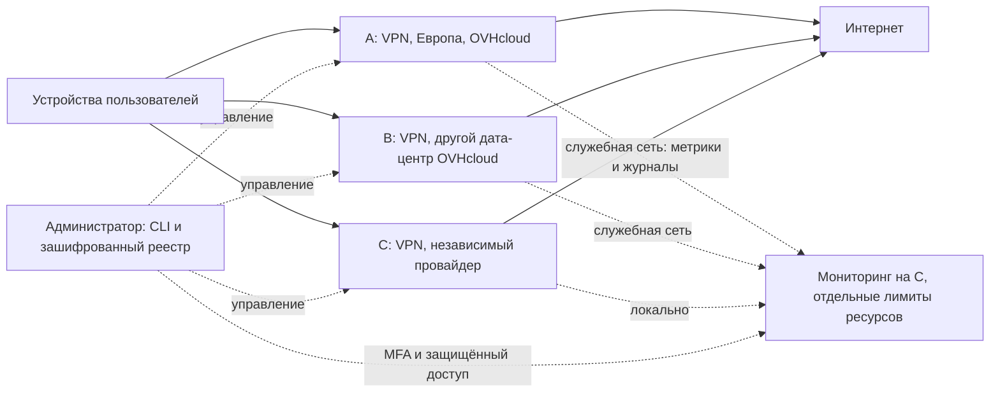

# Частный VPN: предложение архитектуры и план закупки

Дата проверки: 4 ноября 2026 года. Статус: **предложение для согласования**.
Серверы не заказаны; развёртывание, нагрузочные испытания и проверка доступности из РФ не выполнялись.

**Изменение бюджета:** владелец запросил предел €50/месяц. Текущая рекомендация — [два узла с бюджетом €50](budget-50-eur.md). Приведённые ниже трёхузловая рекомендация и бюджеты €65–118,75 сохранены как исходный расширенный вариант и не являются текущим предложением к закупке.

## 1. Зафиксированные требования

- До 100 близких владельцу пользователей, до 3 зарегистрированных устройств на пользователя.
- До 300 устройств в реестре; ожидается 30–70 одновременно активно передающих данные устройств.
- Основная нагрузка: YouTube 1080p, иногда 4K, мессенджеры, звонки, браузер. Торренты не приоритетны.
- По умолчанию весь интернет-трафик через VPN. Исключения для выбранных российских сервисов допустимы как дополнительная функция.
- Linux, Windows, macOS, iOS, Android; телевизоры по возможности, включая подключение через роутер.
- Владелец живёт в РФ, оформляет хостинг как физическое лицо. VPS пока нет.
- Предпочтительны Европа и Америка. Текущий предел бюджета €50 в месяц; первоначальный ориентир €50–120 пересмотрен.
- Приоритеты: безопасность, стабильность, высокая скорость. Нужны обзор трафика, журналы и обнаружение инцидентов.
- Публичная регистрация, биллинг и коммерческие функции не нужны. Платность доступа пока явно не подтверждена.
- Архитектуру согласовать до реализации. Покупка и заказ серверов требуют отдельного явного подтверждения владельца.

## 2. Проверка исходных серверов

Цены «от» ниже являются витринными, а не окончательными предложениями для российского физического лица. Доступность конкретного дата-центра, срок обязательств, продление, налоги и допустимость договора ещё нужно подтвердить. Не указывать фиктивную страну проживания.

| Кандидат | Проверенные сведения | Цена без налогов | Статус закупки |
|---|---|---|---|
| OVHcloud VPS-3, узел A | 6 vCore, 12 ГБ, 100 ГБ NVMe, заявлено 2 Гбит/с | От €10,40/месяц на европейской витрине | Кандидат; итоговая цена и регион не выбраны |
| OVHcloud VPS-3, узел B | Та же конфигурация | От €10,40/месяц | Кандидат; нужен другой физический дата-центр |
| Hetzner CX33, узел C из исходного задания | 4 vCPU, 8 ГБ, 80 ГБ NVMe | Индекс официальной страницы изменения цен показывает €8,49; сама страница при открытии возвращает 404 | Витрина отмечает тариф недоступным; в готовую закупку не включать |
| OVHcloud VPS-4, вариант увеличения ресурсов | 8 vCore, 24 ГБ, 200 ГБ NVMe, заявлено 3 Гбит/с | От €19,96/месяц | Кандидат для масштабирования после тестов |

Источники: [OVHcloud, европейские цены](https://www.ovhcloud.com/en-ie/vps/), [OVHcloud, характеристики и включённые опции](https://www.ovhcloud.com/en/vps/), [Hetzner Cost-Optimized](https://www.hetzner.com/cloud/cost-optimized/), [индексируемая официальная страница изменения цен Hetzner](https://docs.hetzner.com/general/infrastructure-and-availability/price-adjustment/).

У OVHcloud основной IPv4 и стандартная ежедневная копия включены в описание продукта. Для выбранных регионов и условий это надо сверить в заказе. Не переносить европейские условия трафика на азиатские регионы. В конфигураторе без выбранного дата-центра обнаружены неполные/нулевые итоговые значения: они не использованы как цена.

У Hetzner в европейских описаниях указан пакет 20 ТБ. Это месячный объём, а не гарантированная пропускная способность. IPv4 оплачивается отдельно; точную цену адреса и превышения нужно подтвердить в актуальной корзине. [Биллинг Hetzner](https://docs.hetzner.com/cloud/billing/faq/)

### Независимый третий провайдер

Покупать CX33 только потому, что он фигурировал в исходном задании, нельзя. Ни наличие сервера, ни оформление на резидента РФ пока не подтверждены. Публичного актуального подтверждения допуска российского физического лица к заказу OVHcloud/Hetzner в ходе проверки также не получено. Это неизвестное условие, а не доказательство запрета или разрешения.

Как альтернативный кандидат проверен HOSTKEY: официальная витрина VPN-VPS показывает `vm.v3-medium`, 8 vCPU, 16 ГБ, 160 ГБ NVMe, IPv4, порт 1 Гбит/с и **только 3 ТБ** включённого трафика за €16/месяц. Этого пакета мало для равноправного третьего видеосервера. Нужна отдельная цена на расширение трафика, выбранный регион и договор. Российская витрина рекламирует аренду европейских серверов и оплату картами «МИР», но условия международной и российской витрин нельзя считать одинаковыми. [Конфигурация HOSTKEY](https://hostkey.com/vps/vpn/), [российская витрина](https://hostkey.ru/dedicated-servers/europe/)

До покупки третьего узла необходимо получить проверяемое предложение: независимый провайдер, подходящий регион, оформление на реальные данные владельца, канал порядка 1 Гбит/с, не менее 15–20 ТБ исходящего трафика либо приемлемая полная стоимость его использования. Если бюджет этого не позволяет, такой узел остаётся ограниченным аварийным резервом, что должно быть явно отражено в доступности сервиса.

## 3. Две архитектуры

### А. Минимальная надёжная

Два VPN-сервера у независимых провайдеров. Устройства получают основной и резервный профиль. В штатном режиме пользователи распределены между узлами, при отказе вручную выбирают резерв. Один узел содержит мониторинг; его отказ не должен останавливать второй VPN-сервер.

Преимущества: меньше расходов и настроек. Ограничения: каждый узел должен выдерживать всю согласованную нагрузку; меньше запаса на обновления и длительные отказы. Два OVHcloud в разных дата-центрах дают географический резерв, но не независимость от провайдера.

### Б. Исходный расширенный вариант: три самостоятельных узла

Два OVHcloud VPS-3 в разных европейских дата-центрах и третий узел независимого провайдера. Все три способны работать без постоянной доступности административного компьютера. Начальное распределение нагрузки: 40% / 40% / 20%, затем корректировка по измерениям и месячным квотам.

Предварительные кандидаты регионов A/B: Польша и Франция либо Германия, если доступны в заказе. Это гипотеза для испытаний, а не доказанно лучшие маршруты. Для C предпочтительна восточная часть Северной Америки, если нужны американский выход и приемлемые задержки. Если там не проходит бюджет или тесты, выбрать независимую европейскую точку; американскую добавить позже отдельным решением. Канадский узел даёт североамериканское размещение, но не американский IP США.

В пользовательском тракте нет общего прокси, балансировщика или обязательного центрального шлюза. Используются отдельные профили с явно заданными узлами. DNS round-robin не считается механизмом проверки здоровья или надёжного переключения.

Переход на резерв сначала ручной: выбрать в приложении другой профиль. Текущие звонки и загрузки могут переподключиться из-за смены внешнего IP. Переключение на другой сервер и автоматическое переподключение к тому же серверу после обрыва — разные функции. Общее автоматическое переключение для всех ОС и телевизоров в первую версию не включать.

## 4. Протоколы и клиентские устройства

WireGuard остаётся базовым вариантом для простоты и скорости, но доступность UDP и конкретного IP должна быть проверена из пользовательских сетей. Для российских сетей включить в пилот AmneziaWG с официальным клиентом; окончательную версию протокола и серверных пакетов зафиксировать после проверки совместимости и обновлений безопасности. Это готовая реализация, собственная криптография не разрабатывается.

OpenVPN с современным TLS и сертификатами устройств — кандидат резервного транспорта там, где UDP недоступен. TCP/443 сам по себе не делает VPN нераспознаваемым. IKEv2/IPsec полезен при требованиях к нативным клиентам и MOBIKE, но не устраняет проблему ограничения UDP. Headscale/NetBird стоит предпочесть при существенном росте требований к самостоятельной регистрации и SSO; для административной выдачи 300 профилей их дополнительные сервисы пока не обоснованы.

Источники: [WireGuard](https://www.wireguard.com/quickstart/), [OpenVPN](https://openvpn.net/community-docs/community-articles/openvpn-2-6-manual/), [strongSwan MOBIKE](https://docs.strongswan.org/docs/latest/features/mobike.html), [Amnezia Self-hosted FAQ](https://docs.amnezia.org/faq/).

| Устройства | План подключения | Ограничение |
|---|---|---|
| Windows, macOS, Linux | Официальный совместимый VPN-клиент | Проверить версии ОС и клиента |
| Android, iPhone/iPad | Официальный клиент, профиль отдельного устройства | Проверить фоновые ограничения и системную блокировку трафика вне VPN |
| Android TV / Google TV / Fire TV | Приложение, если поддерживается конкретной моделью; иначе роутер | Не обещать поддержку каждого магазина приложений |
| Apple TV | Совместимый tvOS-клиент при подтверждении протокола; иначе роутер | Приложение iPhone не означает поддержку tvOS |
| Samsung Tizen, LG webOS и прочие | VPN на совместимом роутере или отдельном домашнем шлюзе | Установка обычного Android/iOS-клиента не предполагается |

Роутер — одно зарегистрированное VPN-устройство, за которым может быть несколько физических устройств. Ограничение «3 устройства» относится к зарегистрированным профилям. Надёжно отличать копии одного профиля или считать устройства за NAT без дополнительных механизмов нельзя. Производительность роутера, особенно для 4K, проверяется отдельно.

## 5. Российские сервисы и выборочная маршрутизация

Первый режим — полный туннель. Дополнительный режим — список конкретных сервисов, направляемых напрямую на клиенте/роутере. VPN при открытии такого сайта целиком не выключается: другие приложения продолжают использовать туннель.

Не использовать весь `.ru` или все российские IP как автоматически доверенный список. Список доступных ресурсов оператора в условиях ограничений связи и список исключений VPN решают разные задачи. Для сервиса с несколькими доменами/CDN нужны все необходимые зависимости; IP-исключение может затронуть другие сайты на общем адресе. Поддержка разделения по приложениям зависит от ОС. [Ограничения split tunneling Amnezia](https://docs.amnezia.org/documentation/instructions/vpn-split-tunneling/)

Прямые исключения сознательно открывают соответствующий трафик местному оператору. Их совместимость с блокировкой трафика при обрыве, DNS, IPv6, DoH и QUIC проверяется отдельно. Пока тест не пройден, для этой платформы остаётся полный туннель. Если сеть вообще не допускает соединение с зарубежным VPN-узлом, добавление обычного зарубежного VPS само по себе не исправляет доступность.

## 6. Расчёт нагрузки — допущения, не результаты тестов

Условная смешанная модель на активно передающее устройство: 70% потоков по 6 Мбит/с, 10% по 25 Мбит/с, 20% по 1 Мбит/с. Получается 6,9 Мбит/с в среднем; с 20% запаса — 8,28 Мбит/с. Реальные битрейты видео адаптивны. Запас здесь не является точным расчётом служебных заголовков протокола.

| Активных устройств | Смешанная нагрузка с запасом, Мбит/с | Все смотрят 4K по 25 Мбит/с, с запасом |
|---:|---:|---:|
| 25 | 207 | 750 |
| 30 | 248,4 | 900 |
| 50 | 414 | 1 500 |
| 70 | 579,6 | 2 100 |
| 75 | 621 | 2 250 |
| 100 | 828 | 3 000 |
| 200 | 1 656 | 6 000 |
| 300 | 2 484 | 9 000 |

100 пользователей одновременно могут означать 100, 200 или 300 активных устройств. Наличие 300 ключей не означает поддержку 300 одновременных 4K-потоков.

### Отказ одного из трёх узлов

Предварительный критерий: каждый узел выдаёт не менее 800 Мбит/с полезного смешанного VPN-трафика на длительном тесте. Для планирования используем не более 70% измеренной ёмкости, то есть 560 Мбит/с на узел. Два оставшихся узла дают 1 120 Мбит/с плановой ёмкости: этого достаточно для расчётных 828 Мбит/с на 100 активных устройств при равномерном распределении.

Это условный вывод: сначала требуется измерить 800 Мбит/с на каждом узле и проверить маршруты к реальным пользователям. Для сценария 200/300 активных устройств и для 100 одновременных 4K эта модель N+1 недостаточна. Требуется расширение или согласованное ограничение нагрузки. Для двухузлового варианта при тех же критериях оставшийся один сервер не обеспечивает расчётную нагрузку 100 устройств с выбранным запасом.

Нельзя складывать рекламные скорости портов и объявлять результат скоростью сервиса. Нужно уточнить лимиты входящего/исходящего/суммарного канала, PPS, CPU steal, маршруты, шифрование и ограничения виртуализации. Пилот не должен использовать пользовательские видеосервисы как генератор искусственной массовой нагрузки.

### Месячный исходящий трафик

Формула: 1 Мбит/с в течение часа = 0,45 ГБ (десятичные единицы). Потребление рассчитывается на человека, а не умножается автоматически на три устройства. Сверить единицы с биллингом провайдера.

| Сценарий | Допущение на 100 человек | Общий исходящий объём с 15% запасом |
|---|---|---:|
| Умеренный | 2 ч/день видео 6 Мбит/с; ещё 20 ГБ/чел./месяц | 20,93 ТБ/месяц |
| Рабочий | 3 ч/день видео 8 Мбит/с; 10 человек дополнительно 0,5 ч/день 4K 25 Мбит/с; ещё 30 ГБ/чел. | 42,65 ТБ/месяц |
| Интенсивный | 4 ч/день видео 8 Мбит/с; 20 человек дополнительно 1 ч/день 4K; ещё 50 ГБ/чел. | 63,19 ТБ/месяц |

При 40/40/20 рабочий сценарий даёт около 17,06 / 17,06 / 8,53 ТБ. При равномерном распределении после длительного отказа одного узла — по 21,33 ТБ на оставшийся. Квота 20 ТБ может быть превышена; квота 3 ТБ недостаточна даже для штатной доли. Считать исходящие байты интерфейса и сверять с провайдером; не удваивать автоматически объём загрузки только из-за двух сторон VPN-сервера.

## 7. Смета и пределы закупки

Этот раздел описывает первоначальные варианты при большем бюджете. Актуальное предложение и денежные ограничения €50 — в [пересмотренном варианте](budget-50-eur.md).

Окончательная смета пока **не подтверждена**: не выбраны регион и срок оплаты OVHcloud, CX33 недоступен, третий провайдер не утверждён, налоговый режим заказа неизвестен. Ниже два разных вида чисел.

Витринная нижняя граница первоначальной комбинации: `2 × €10,40 + €8,49 = €29,29` без IPv4 Hetzner, налогов, отдельных копий и превышений. Это арифметический ориентир для сравнения, не доступная корзина и не основание оплачивать год вперёд.

### Предлагаемые бюджетные ограничения, а не тарифы провайдеров

Все суммы в евро за месяц. 25% — только резерв неопределённости налогов и сборов, а не заявленная ставка НДС. Фактический налог должен быть в счёте; этот резерв не гарантирует, что он окажется достаточным.

| Статья | Экономный, 3 узла | Рекомендуемый, 3 узла | С увеличенным запасом, 3 узла |
|---|---:|---:|---:|
| Узел A, лимит на VPS и основной IPv4 | 15 | 15 | 25 |
| Узел B, лимит на VPS и основной IPv4 | 15 | 15 | 25 |
| Узел C независимого провайдера, с IPv4 | 12 | 30 | 30 |
| Внешняя зашифрованная копия, резерв | 5 | 5 | 5 |
| ПО мониторинга на существующем C | 0 | 0 | 0 |
| Домен: не обязателен при закрытой панели | 0 | 0 | 0 |
| Дополнительный исходящий трафик, резерв | 5 | 15 | 10 |
| Подытог | 52 | 80 | 95 |
| Резерв неопределённости 25% | 13 | 20 | 23,75 |
| **Плановый месячный потолок** | **65** | **100** | **118,75** |

Экономный вариант реалистичен только при появлении доступного дешёвого третьего узла с подходящим трафиком, оформляемого на владельца; сейчас это не подтверждено. Рекомендуемый оставляет €30 на независимый C и €15 на превышения. Вариант с запасом предполагает проверку VPS-4 вместо VPS-3, но увеличение RAM само по себе скорость не гарантирует. Цена продления, установка, комиссия оплаты или трафик, не помещающиеся в эти пределы, требуют пересмотра выбора до заказа. Труд администратора, домашний роутер и внешняя независимая система мониторинга в таблицу не включены.

## 8. Безопасность, управление и наблюдаемость

Подробности — в [плане безопасности и мониторинга](security-monitoring-plan.md).

Предлагается административный CLI с зашифрованным реестром пользователей/устройств и публичными ключами на серверах. Отзыв применяется к каждому узлу с подтверждением результата. Недоступный при отзыве узел считается несогласованным и не возвращается в обслуживание до синхронизации. Клиентские приватные ключи по возможности создаются на устройствах, административные экспорты хранятся зашифрованно и удаляются после выдачи.

Нельзя честно обещать, что работающий сервер никогда не обрабатывает секреты в открытом виде: собственный серверный ключ нужен процессу/ядру. Ограничиваются права, доступ, резервные копии и журналы; компрометация root остаётся критической угрозой.

## 9. Подготовка аренды и установки

1. Подтвердить топологию и допустимость ручного перехода на резерв. Отдельно подтвердить бесплатность/платность доступа.
2. До оплаты проверить договор с реальными страной/данными владельца, допустимость частного VPN, KYC, методы оплаты и правила трафика. Изучить условия соответствующего юридического лица провайдера, а не только языковую витрину.
3. OVHcloud: открыть [официальный раздел VPS](https://www.ovhcloud.com/en/vps/), перейти к VPS-3 и выбрать физический дата-центр. Для пилота предпочесть месячную оплату без длительного обязательства; сверить полную цену и продление.
4. Независимый узел: заказать только после подтверждения полного предложения на регион/трафик/IPv4. Не покупать отсутствующий CX33 и не считать HOSTKEY 3 ТБ безлимитным.
5. ОС: предварительно Ubuntu 24.04 LTS, если выбранный релиз VPN и пакеты её поддерживают. Если образа или поддержки нет, перед выбором другого LTS проверить совместимость; не выбирать новую ОС исключительно по номеру версии.
6. Сеть: основной IPv4, доступ к аварийной консоли, минимальные входящие правила. IPv6 либо полноценно обслуживается туннелем, либо блокируется от обхода на клиентах. Одного отключения IPv6 на сервере недостаточно.
7. Не покупать Plesk/cPanel, Windows, балансировщик, дополнительные IP и диски без конкретной необходимости. Включённая копия провайдера не заменяет независимую зашифрованную копию конфигурации.
8. Начальный доступ: добавить публичный SSH-ключ; если выдан временный пароль — вводить локально, заменить и отключить парольный вход после проверки доступа и аварийной консоли. Секреты не присылать в чат.
9. Перед VPN: проверить адреса, время, обновления, SSH host key доверенным каналом, firewall, маршруты и исходящий доступ. Подготовить автоматический откат сетевых изменений, пока новый доступ не подтверждён.
10. После отдельного разрешения на покупку — короткий пилот, затем настройка остальных узлов. Скрипты установки и инфраструктурный код создаются после согласования архитектуры; они не будут содержать production-секреты.

Не создавать аккаунты, заказы, платные обязательства или обращения провайдерам без соответствующего разрешения. Можно подготовить текст обращения для проверки договора, трафика и регионов, не отправляя его.

## 10. Испытания и критерии приёмки

Предлагаемые целевые значения ниже должны быть согласованы и подтверждены, не являются SLA или уже измеренными свойствами.

| Проверка | Критерий |
|---|---|
| Нагрузка | 25, 50, 75, 100 активных тестовых профилей; отдельно 200/300 как стресс-сценарии |
| Ёмкость | Каждый узел не менее 800 Мбит/с полезной смешанной нагрузки 60 минут; прогон с переменным трафиком 24 часа |
| Запас | Средняя CPU под рабочей нагрузкой <70%; RAM <75%; без OOM, swap thrashing и устойчивой перегрузки conntrack |
| Задержка | Для одинакового маршрута к контролируемой цели: рост p95 RTT под нагрузкой относительно холостого VPN ≤30 мс; не сравнивать разные географические пути как одинаковые |
| Звонки | На доступных контрольных путях loss <1%, jitter p95 <30 мс при рабочей нагрузке |
| Отказ | Поочерёдно отключить каждый узел; остальные сохраняют доступ и выдерживают рабочий профиль; ручное переключение после обнаружения ≤2 минут при готовом пользователе |
| Восстановление | После возврата сети переподключение к прежнему серверу ≤30 секунд на проверенных клиентах; Wi-Fi ↔ LTE, сон/пробуждение |
| Утечки | В полном туннеле отсутствует пользовательский DNS/IPv6/IPv4 вне туннеля при подключении, обрыве и переключении; разрешён только необходимый служебный трафик |
| Исключения | Прямой маршрут только для выбранных сервисов; посторонние соединения остаются в VPN; отдельно проверить CDN, DoH/QUIC и конфликт с kill switch |
| Управление | Четвёртое устройство в реестре не создаётся; отзыв блокирует доступ на всех доступных узлах; неготовый узел не возвращается после простоя без синхронизации |
| Мониторинг | Синтетическая недоступность и ошибки дают ожидаемые события и оповещение; проверить отказ самого сборщика |
| Резервная копия | Восстановление в чистую ОС, сверка списка отозванных устройств; открытые клиентские ключи и история трафика в копию не попадают |

Синтетическую нагрузку генерировать между контролируемыми тестовыми машинами через реальные туннели и разрешёнными провайдерами средствами. Проверить, что генератор сам не является узким местом. Функциональные видеотесты выполнять на согласованном небольшом наборе устройств, без массового автоматического обращения к YouTube.

Если не выполняется ёмкость: определить ограничение CPU/порта/маршрута/PPS, затем проверить VPS-4 либо тариф с выделенным CPU/более широким каналом. Если не проходит доступность протокола — смена RAM проблему не решает. При прогнозе 200–300 активных устройств пересчитать N+1 и бюджет; не обещать сохранить исходные €120 для любого сценария.

## 11. Правовые границы

Личный VPN, закрытая инфраструктура для близких, бесплатный публичный доступ и коммерческая услуга — разные сценарии. Отсутствие оплаты или регистрации для посторонних не создаёт общего освобождения от обязанностей.

На дату проверки ч. 17 ст. 15.8 №149-ФЗ связывает исключение с заранее определённым кругом пользователей **и** технологическими целями обеспечения деятельности. Соответствие нашей модели требует отдельной оценки; обычный досуг близких нельзя автоматически объявить подпадающим под это исключение. [Действующая опубликованная редакция статьи](https://www.consultant.ru/document/cons_doc_LAW_61798/1a807328c80a540bd0bb724927d6e774595431dc/)

Перед эксплуатацией проверить применимость обязанностей владельца сервиса, действующие положения КоАП (в том числе о порядке использования VPN и рекламе), законодательства о персональных данных и правила стран размещения. Эта проверка ещё не завершена. Не называть сервис No-Logs, анонимным или гарантированно неблокируемым. Не распространять доступ публично, пока это не оформлено как отдельное изменение модели и не проверены обязанности.

## 12. Что ещё не утверждено

- Согласование текущего двухузлового предложения в пределах €50/месяц; прежняя рекомендация B за €100 заменена бюджетной ревизией.
- Допустимость ручного выбора резервного профиля и бесплатность доступа.
- Полное предложение независимого третьего провайдера и оформление договоров на резидента РФ.
- Конкретные дата-центры, фактические цены/налоги и возможность североамериканского C в бюджете.
- Набор реальных клиентских устройств и сетей для пилота; канал оповещений администратора.
- Результаты всех испытаний: пока отсутствуют.

Следующее действие владельца — подтвердить топологию из бюджетной ревизии и ручной резерв с уменьшенной аварийной ёмкостью. Это согласование разработки, а не разрешение покупать серверы.
