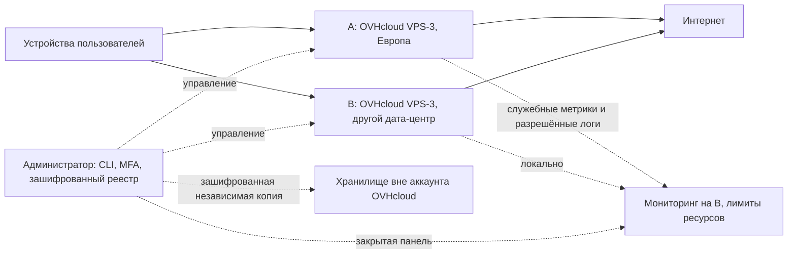

# Вариант с месячным пределом €50

Дата: 4 ноября 2026 года. Статус: **архитектура согласована владельцем, начата локальная реализация**.
Заменяет рекомендацию трёх узлов за €100 из первоначального предложения. Заказы и установка на VPS не выполнялись; актуальное состояние — в [README](../README.md).

## Рекомендация

Начать с **двух OVHcloud VPS-3 в разных европейских физических дата-центрах**. Отдельный американский узел и независимого третьего провайдера отложить. Ресурсы каждого сервера пока сохранить: сокращение с трёх узлов до двух экономит больше, чем уменьшение RAM, и оставляет больше места для VPN и мониторинга.

На проверенной европейской витрине VPS-3 указан от €10,40 без налогов в месяц, с 6 vCore, 12 ГБ RAM, 100 ГБ NVMe и заявленным каналом 2 Гбит/с. Основной IPv4 и стандартная ежедневная копия включены в описание продукта. Это витринная цена: срок обязательств, регион, продление и итоговые налоги проверяются в заказе. [Официальная страница OVHcloud](https://www.ovhcloud.com/en-ie/vps/)

Не покупать годовой тариф ради достижения рекламной месячной цены до пилота. Оформление и допустимая оплата на реальные данные физического лица из РФ пока не подтверждены. Если договор недоступен или итоговая месячная цена не укладывается в ограничения ниже, этот список нельзя считать готовым к покупке: потребуется другой провайдер/тариф с новым расчётом.

## Состав и денежные ограничения

Это **распределение предельного бюджета**, а не подтверждённая коммерческая смета. В отличие от прежней таблицы, лимиты ниже уже должны включать фактические налоги, основной IPv4, комиссии и регулярные обязательные платежи.

| Статья | Месячный предел, включая налоги и сборы |
|---|---:|
| A: VPS-3, Европа, первый дата-центр | €17 |
| B: VPS-3, Европа, другой физический дата-центр | €17 |
| Независимое хранение зашифрованной конфигурации | €4 |
| Prometheus/Grafana/Loki/Alloy на B, лицензии | €0 |
| Домен и отдельный балансировщик | €0 — не нужны для закрытого управления |
| Нераспределённый резерв: колебания счёта, трафик, внешняя проверка | €12 |
| **Общий предел** | **€50** |

Два рекламных тарифа дают нижнюю границу €20,80 до налогов и прочих условий; это не итоговая цена двух серверов. Перед оплатой сверяются месячная цена без длительного обязательства, цена продления, разрешённый объём/политика трафика и сумма первого платежа. Мониторинг занимает ресурсы B, поэтому его бесплатные лицензии не означают отсутствие нагрузки на сервер.

€4 — резерв на небольшую внешнюю копию, а не проверенный тариф хранения. При наличии подходящего собственного носителя/места можно хранить зашифрованную копию на отдельном компьютере владельца без новой ежемесячной подписки; регулярность и восстановление всё равно проверяются. Копия на втором VPS того же провайдера не считается независимой от провайдера.

Никаких автоматических платных масштабирований. Предупреждения о расходах сами по себе не ограничивают счёт: до заказа необходимо исключить или ограничить платные опции и проверить договорные условия. Если возникает обязательный платёж сверх €50, он не считается автоматически разрешённым. Работа администратора, домашний интернет, новый роутер или аппаратный ключ не входят в месячную аренду и оплачиваются отдельно только при необходимости и согласовании.

## Архитектура

Штатное распределение — примерно 50/50 по реальной нагрузке. У каждого устройства есть профиль A и профиль B; выбор другого узла сначала ручной. Устройство в реестре считается один раз, несмотря на два серверных профиля. Разные ключи устройств, отзыв на обоих узлах, сегментация и правила DNS/IPv6 сохраняются.

Два дата-центра дают резерв при отказе одного узла/площадки, но **не дают независимость от OVHcloud, одного аккаунта, его оплаты или общей сети провайдера**. Второй независимый провайдер лучше устранил бы этот риск, но проверенные предложения с подходящим видеотрафиком в пределах €50 пока не найдены. Уменьшенный вариант не следует называть равноценным прежнему по отказоустойчивости.

## Производительность и пределы обслуживания

Сохраняется до 100 пользователей и 300 зарегистрированных устройств. Это лимит реестра, не обещание одновременно обслужить 300 видеопотоков.

Из прежней условной смешанной модели: 8,28 Мбит/с на активно передающее устройство, включая плановый запас. Числа не измерены и не означают фиксированный битрейт любого видео.

| Одновременно активных устройств | Суммарная расчётная нагрузка | На узел при 50/50 |
|---:|---:|---:|
| 30 | 248,4 Мбит/с | 124,2 Мбит/с |
| 50 | 414 Мбит/с | 207 Мбит/с |
| 70 | 579,6 Мбит/с | 289,8 Мбит/с |
| 100 | 828 Мбит/с | 414 Мбит/с |
| 300 | 2 484 Мбит/с | 1 242 Мбит/с |

Цель пилота: каждый VPS, в том числе B с мониторингом, устойчиво передаёт не менее 800 Мбит/с полезной смешанной нагрузки. Для планирования используем не более 70% этой измеренной ёмкости: 560 Мбит/с на узел, 1 120 Мбит/с при двух работающих узлах. Поэтому 30–70 устройств и 100 устройств в смешанной модели являются кандидатами для проверки, а не гарантией рекламной страницы.

При отказе одного узла остаются 560 Мбит/с плановой ёмкости. Рабочая аварийная цель — до 50 активных устройств (414 Мбит/с); на 70/100 устройствах прежний запас уже не соблюдается. Возможны адаптивное снижение качества видео и временные ограничения тяжёлых загрузок. В первую версию не включать постоянную слежку за приложениями ради распознавания YouTube: управление основано на узлах/профилях и общих лимитах.

100 одновременных 4K-потоков по 25 Мбит/с с запасом требуют около 3 Гбит/с, а 300 — 9 Гбит/с. Такой сценарий в €50 не обещается. Качество 1080p и отдельные 4K проверяются на реальных клиентах; скорость роутеров и домашних каналов проверяется отдельно.

Рабочая модель месячного объёма остаётся около 42,65 ТБ на весь сервис, то есть 21,33 ТБ на узел при равномерной нагрузке. Сокращение числа серверов не уменьшает автоматически пользовательский трафик. Для европейских предложений OVHcloud витрина заявляет unlimited traffic, но правила использования и применимость к выбранному заказу обязательны к проверке. Не заменять резерв сервером с 3 ТБ включённого трафика без отдельной полной цены.

## Безопасность и наблюдаемость

Сохраняется [план безопасности](security-monitoring-plan.md): закрытая панель с MFA, firewall, административная сегментация, обновления, ключи каждого устройства, отзыв на обоих узлах, зашифрованные копии, минимальные журналы, мониторинг и тревоги. История сайтов и содержимое пакетов не собираются.

Grafana/Prometheus/Loki работают на B с отдельными лимитами ресурсов. Alloy — на A/B. Если B падает, VPN на A продолжает работу, но центральная панель и часть оповещений недоступны. A должен проверять B и сохранять ограниченные локальные события. Для обнаружения общего отказа обоих узлов нужна проверка вне OVHcloud; имеющийся компьютер владельца может помогать, но не заменяет круглосуточную внешнюю проверку, когда выключен или потерял сеть. Конкретный внешний канал должен быть выбран в оставшийся резерв или явно отмечен как отсутствующий.

Межсерверная передача разрешённых журналов сохраняется; отказ сборщика не должен заполнять диск A. Масштаб крупного DDoS обслуживается upstream-защитой провайдера, не увеличением объёма локальных логов.

## Что сокращается

- Третий узел и независимость от одного хостинга.
- Американская точка подключения на старте; первая версия только в Европе.
- Аварийная ёмкость: цель до 50 активно передающих устройств после отказа одного узла.
- Отдельный сервер наблюдаемости; мониторинг совмещён с B и ограничен по ресурсам.

Что не утверждается без испытаний: фактическая скорость, доступность из российских сетей, результаты DNS/IPv6-тестов, качество видео и доставка тревог. Покупка не выполнялась; согласование этой архитектуры не является разрешением заказать серверы.
